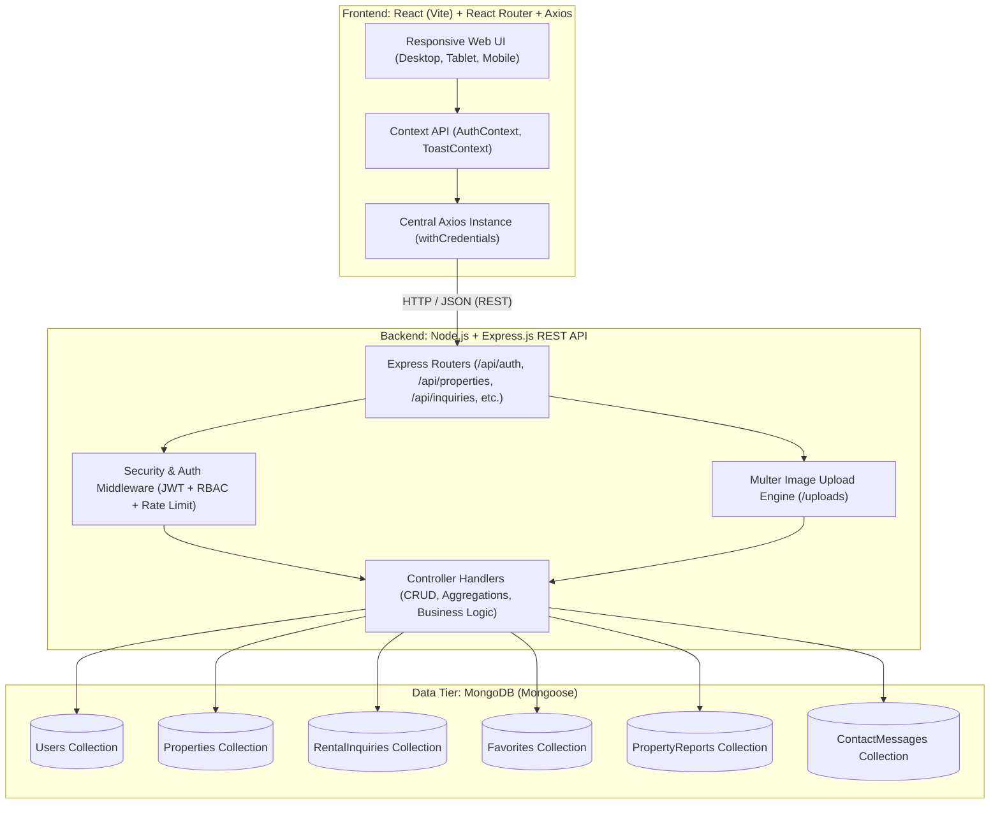
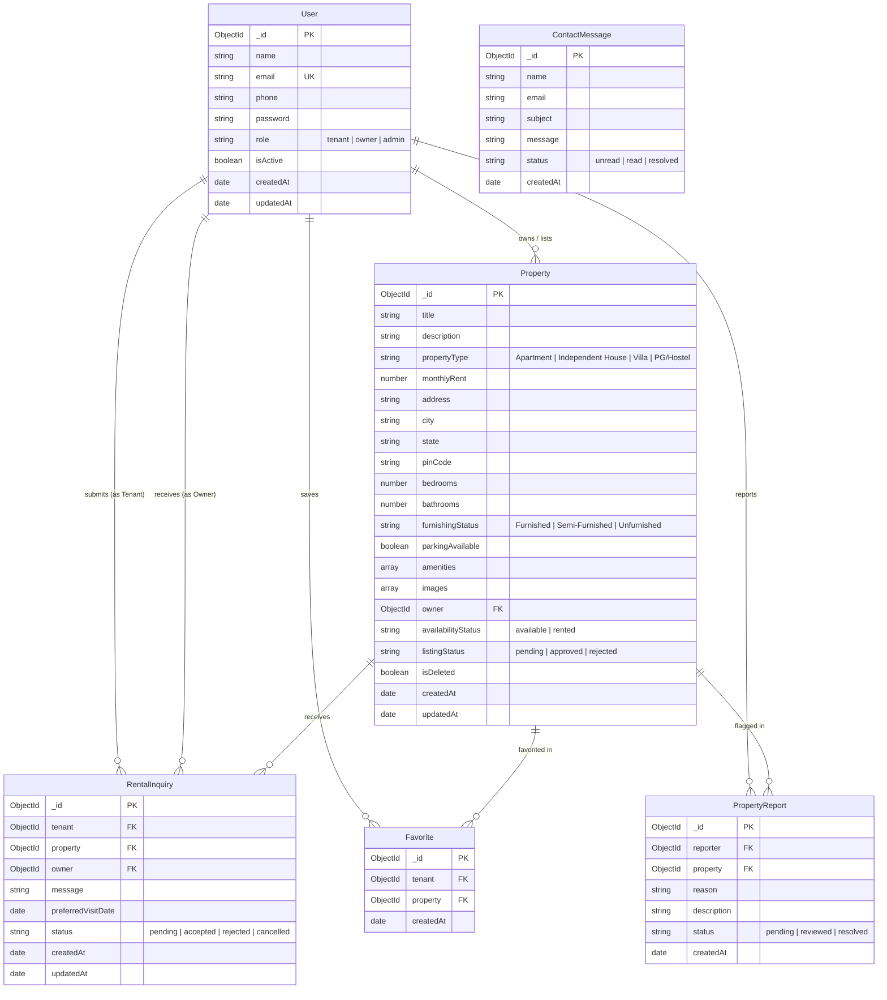

# Property Listing & Rental Portal (RentNest)
**A Full-Stack Web Application for Modern Real Estate Rentals (MERN Stack)**  
*Full Stack Development (FSD) Semester Capstone Project*

---

## 1. Project Abstract
The **Property Listing & Rental Portal** (branded as **RentNest**) is a production-grade full-stack web application engineered to bridge the divide between residential property owners (landlords) and prospective tenants across major Indian cities (Hyderabad, Visakhapatnam, Vijayawada, Bengaluru, etc.). Built on the MERN stack (MongoDB, Express.js, React.js, Node.js), RentNest removes unnecessary intermediary brokerage overheads, verifies property listings with multi-image photographic evidence, enforces role-based access control (RBAC), and manages the end-to-end rental inquiry and property viewing lifecycle.

---

## 2. Problem Statement
Traditional house hunting in metropolitan urban hubs is plagued by:
1. **Exorbitant Brokerage Commissions**: Intermediaries charge 1–2 months of rent with minimal transparency.
2. **Fake & Outdated Advertisements**: Portals frequently display stock photos, non-existent listings, or already-rented homes.
3. **Fragmented Communication**: Inquiries sent via random chat apps lead to missed visits, lack of scheduling, and zero record persistence.
4. **Lack of Governance**: Platforms without strict administrative moderation suffer from duplicate listings and fraudulent scams.

RentNest solves these systemic issues by centralizing verified listings, direct owner-tenant communication, automated availability toggles, and administrator oversight in a unified, responsive web portal.

---

## 3. Project Objectives
- **Direct Landlord-Tenant Connection**: Enable verified landlords to publish accommodations and tenants to book viewing appointments without brokerage commissions.
- **Dynamic Multi-Parameter Discovery**: Support real-time search by city/locality, budget range (in INR), property type (Apartment, House, Villa, PG), bedroom count (BHK), and furnishing status.
- **Role-Based Security**: Provide customized workspaces for **Tenants**, **Property Owners**, and **Administrators** protected by JSON Web Tokens (JWT) and HttpOnly cookies.
- **Persistent Data & Media Storage**: Persist users, properties, favorites, inquiries, moderation reports, and contact queries in MongoDB using Mongoose ObjectIds and indexes, with Multer disk uploads.

---

## 4. System Architecture



---

## 5. Technology Stack & Technical Rationale

| Layer | Technology | Technical Rationale |
|---|---|---|
| **Frontend Framework** | **React.js 18 (Vite)** | Lightning-fast Hot Module Replacement (HMR), component-driven UI architecture, lightweight virtual DOM reconciliations. |
| **Client Routing** | **React Router DOM v6** | Declarative nested routing, history stack navigation, protected route guards, and role-based redirects. |
| **HTTP Client** | **Axios** | Interceptor-driven error handling, automatic JSON transformation, and cookie-based authentication (`withCredentials: true`). |
| **Styling & Design** | **Modern CSS3** | Custom design system using CSS variables, responsive CSS Grid / Flexbox layouts, accessible color contrast, and zero heavyweight runtime CSS dependencies. |
| **Icons** | **Lucide React** | Lightweight, tree-shakable SVG icon set for clean real-estate visual indicators. |
| **Server Framework** | **Node.js & Express.js** | Asynchronous, non-blocking I/O event loop, robust middleware ecosystem, and standard RESTful JSON conventions. |
| **Authentication** | **JWT & bcryptjs** | Stateless JSON Web Tokens stored in `HttpOnly` cookies to guard against XSS; 10-round salted bcrypt hashing for passwords. |
| **Media Handling** | **Multer** | Multipart form-data handling, disk storage with safe unique filenames, MIME-type whitelisting (JPEG/PNG/WebP), and file size limits (5MB). |
| **Database** | **MongoDB & Mongoose** | Flexible schema validation, compound indexes for fast geospatial/budget queries, automated timestamps, and relational population (`ObjectId`). |
| **Testing** | **Jest & Supertest** | Automated end-to-end HTTP integration testing for API status codes, security boundaries, and data integrity. |

---

## 6. Role-Based Feature Matrix

### A. Tenant Features
- **Public Browsing**: View approved listings without logging in; filter by city, budget, property type, BHK, and amenities.
- **Detailed Inspection**: High-resolution image galleries, owner specifications, society facilities, and mapped address.
- **Wishlist / Favorites**: Save properties to personal favorites with single-click removal.
- **Rental Inquiries & Viewing Scheduling**: Submit inquiries specifying preferred date of visit; cancel pending requests.
- **Inquiry Dashboard**: Real-time tracking of inquiry states: `Pending`, `Accepted`, `Rejected`, or `Cancelled`.
- **Property Reporting**: Report fraudulent or misleading listings directly to administrators.

### B. Property Owner Features
- **Owner Dashboard**: Real-time metrics on total properties, active listings, rented units, and incoming inquiries.
- **Publish Listing**: Multi-step form with title, rent (INR), location, bedrooms, bathrooms, furnishing, parking, society amenities, and multi-image uploads.
- **Portfolio Management**: Edit listing specifications, remove obsolete photographs, toggle status (`Available` ↔ `Rented`), or delete listings.
- **Inquiry Moderation**: Review tenant applicant profile (name, phone, email, message) and Accept or Decline inquiries with instant database updates.

### C. Administrator Features
- **Admin Command Center**: System-wide analytical breakdown of total users, tenants, owners, properties, inquiries, and complaints.
- **User Governance**: Search and inspect registered users; activate or suspend accounts with self-deactivation protection.
- **Listing Moderation**: Review all properties across `pending`, `approved`, and `rejected` states; moderate inappropriate content.
- **Abuse & Report Triage**: Review tenant complaint reports, inspect reported listings, and mark reports as `reviewed` or `resolved`.
- **Contact Center**: Read and resolve feedback messages submitted through the public contact form.

---

## 7. Database Models & Entity Relationship Diagram (ERD)



---

## 8. REST API Reference

### Authentication (`/api/auth`)
| Method | Endpoint | Access | Description |
|---|---|---|---|
| `POST` | `/api/auth/register` | Public | Register new Tenant or Owner (Admin role blocked) |
| `POST` | `/api/auth/login` | Public | Authenticate user, set HttpOnly cookie & return token |
| `GET` | `/api/auth/me` | Private | Fetch currently authenticated user profile |
| `PUT` | `/api/auth/profile` | Private | Update name or phone number |
| `POST` | `/api/auth/logout` | Public | Invalidate authentication cookie |

### Properties (`/api/properties`)
| Method | Endpoint | Access | Description |
|---|---|---|---|
| `GET` | `/api/properties` | Public | Search, multi-criteria filter, sort, & paginate approved listings |
| `GET` | `/api/properties/featured` | Public | Fetch top 6 featured rental listings |
| `GET` | `/api/properties/my` | Private (Owner) | Fetch all properties listed by current owner |
| `GET` | `/api/properties/:id` | Public | Retrieve full property specifications & owner info |
| `POST` | `/api/properties` | Private (Owner/Admin) | Create listing with Multer multi-image uploads |
| `PUT` | `/api/properties/:id` | Private (Owner/Admin) | Update listing specifications & manage images |
| `DELETE` | `/api/properties/:id` | Private (Owner/Admin) | Soft delete listing |
| `PATCH` | `/api/properties/:id/availability` | Private (Owner/Admin) | Toggle `available` ↔ `rented` status |

### Inquiries (`/api/inquiries`)
| Method | Endpoint | Access | Description |
|---|---|---|---|
| `POST` | `/api/inquiries` | Private (Tenant) | Submit rental inquiry / viewing request |
| `GET` | `/api/inquiries/my` | Private (Tenant) | View inquiries submitted by current tenant |
| `GET` | `/api/inquiries/received` | Private (Owner) | View inquiries received for owner's properties |
| `PATCH` | `/api/inquiries/:id/status` | Private (Owner) | Accept or Reject a pending inquiry |
| `PATCH` | `/api/inquiries/:id/cancel` | Private (Tenant) | Cancel a pending inquiry |

### Favorites (`/api/favorites`)
| Method | Endpoint | Access | Description |
|---|---|---|---|
| `GET` | `/api/favorites` | Private (Tenant) | Retrieve saved wishlist properties |
| `POST` | `/api/favorites/:propertyId` | Private (Tenant) | Add property to favorites |
| `DELETE` | `/api/favorites/:propertyId` | Private (Tenant) | Remove property from favorites |

### Administration (`/api/admin`)
| Method | Endpoint | Access | Description |
|---|---|---|---|
| `GET` | `/api/admin/dashboard` | Private (Admin) | Aggregate metrics for users, listings, inquiries, & reports |
| `GET` | `/api/admin/users` | Private (Admin) | Search, filter, and list users |
| `PATCH` | `/api/admin/users/:id/status` | Private (Admin) | Activate or suspend user account |
| `GET` | `/api/admin/properties` | Private (Admin) | List all properties across all approval states |
| `PATCH` | `/api/admin/properties/:id/approval` | Private (Admin) | Approve or Reject property listing |
| `DELETE` | `/api/admin/properties/:id` | Private (Admin) | Remove inappropriate listing |
| `GET` | `/api/admin/reports` | Private (Admin) | View tenant moderation reports |
| `PATCH` | `/api/admin/reports/:id` | Private (Admin) | Update report status (`reviewed`, `resolved`) |
| `GET` | `/api/admin/contact-messages` | Private (Admin) | View submitted contact messages |
| `PATCH` | `/api/admin/contact-messages/:id/status` | Private (Admin) | Mark contact message as read or resolved |

---

## 9. Installation & Execution Guide

### Prerequisites
- **Node.js**: v18.0.0 or higher (v24.x tested & verified)
- **npm**: v9.0.0 or higher
- **MongoDB**: Local MongoDB instance running on `localhost:27017` or a MongoDB Atlas connection URI.

### Step 1: Clone or Navigate to the Workspace
```bash
cd C:\Users\hp\.gemini\antigravity\scratch\property-listing-rental-portal
```

### Step 2: Configure Environment Variables

**Backend Configuration (`server/.env`):**
```env
PORT=5000
NODE_ENV=development
MONGODB_URI=mongodb://127.0.0.1:27017/rental_portal
JWT_SECRET=fsd_property_rental_portal_jwt_secret_key_2026_xyz987
CLIENT_URL=http://localhost:5173
COOKIE_SECURE=false

# Initial Administrator Credentials (provisioned via seed)
ADMIN_NAME=Platform Administrator
ADMIN_EMAIL=admin@rentalportal.com
ADMIN_PASSWORD=Admin@12345
ADMIN_PHONE=+91 9876543210
```

> **For MongoDB Atlas users**: Replace `MONGODB_URI` with your connection string:
> `MONGODB_URI=mongodb+srv://<username>:<password>@cluster0.xyz.mongodb.net/rental_portal?retryWrites=true&w=majority`

**Frontend Configuration (`client/.env`):**
```env
VITE_API_URL=http://localhost:5000/api
VITE_SERVER_URL=http://localhost:5000
```

### Step 3: Install Dependencies
```bash
# Install root, backend, and frontend packages
npm run install:all
```
*(Or install individually: `cd server && npm install`, then `cd ../client && npm install`)*

### Step 4: Seed Sample Data & Provision Administrator
Run the automated seed script to populate realistic Indian rental properties (Hyderabad, Visakhapatnam, Vijayawada, Bengaluru) and test accounts:
```bash
npm run seed
```
To independently create or update the administrator account safely without public registration:
```bash
npm run create-admin
```

### Step 5: Run Automated Tests
Execute the backend test suite powered by Jest and Supertest:
```bash
npm run test:server
```
*(Runs 14 automated integration tests verifying health checks, auth security, role boundaries, listing filters, and inquiries).*

### Step 6: Start Development Servers

**Terminal 1 (Backend Server):**
```bash
cd server
npm start
# Server listens on http://localhost:5000
```

**Terminal 2 (Frontend Client):**
```bash
cd client
npm run dev
# Vite runs on http://localhost:5173
```

---

## 10. Default Demonstration Credentials

For viva demonstrations and evaluation, the seed script provisions the following accounts:

| Role | Email Address | Password | Notable Data / Features |
|---|---|---|---|
| **Administrator** | `admin@rentalportal.com` | `Admin@12345` | Access to `/admin/dashboard`, user suspension, listing moderation, reports. |
| **Property Owner** | `rajesh.owner@example.com` | `Password@123` | Owns 1 BHK in Hyderabad & Koramangala Flat; manages tenant inquiries. |
| **Property Owner** | `priya.owner@example.com` | `Password@123` | Owns Visakhapatnam Sea-View flat & Gachibowli PG. |
| **Tenant** | `rahul.tenant@example.com` | `Password@123` | Active inquiries and saved favorites in dashboard. |
| **Tenant** | `sneha.tenant@example.com` | `Password@123` | Clean tenant account for testing new inquiries and wishlist. |

*(The login page includes convenient **1-click autofill buttons** for rapid switching between Tenant, Owner, and Admin).*

---

## 11. Common Setup Issues & Troubleshooting

1. **MongoDB Connection Refused (`ECONNREFUSED 127.0.0.1:27017`)**:
   - Verify that your local MongoDB service is running via Windows Services (`net start MongoDB`) or start `mongod`.
   - Alternatively, supply a cloud MongoDB Atlas URI in `server/.env`.
2. **CORS Errors During API Calls**:
   - Ensure `server/.env` contains `CLIENT_URL=http://localhost:5173`.
   - Ensure the frontend runs on port 5173 or an allowed origin.
3. **Images Not Showing in Browser**:
   - The backend serves files statically from the `/uploads` route (`http://localhost:5000/uploads/property-xxx.jpg`). Ensure the backend server is running.
   - For external seed images, an active internet connection is required to fetch Unsplash assets.
4. **JWT Cookie Not Saved in Production**:
   - When deploying to production with HTTPS, ensure `COOKIE_SECURE=true` and `sameSite: 'none'`. For local HTTP development, `COOKIE_SECURE=false` and `sameSite: 'lax'` is configured.

---

## 12. Full-Stack Viva Q&A & Examination Cheat-Sheet

### Q1: How is authentication handled securely without storing passwords or tokens in localStorage?
**Answer**: Passwords are never stored in plaintext; they are salted and hashed using `bcryptjs` with 10 rounds of salt generation before saving to MongoDB via a Mongoose `pre('save')` hook. Upon authentication, a JSON Web Token (JWT) is generated and sent via an `HttpOnly` cookie. Because `HttpOnly` cookies cannot be accessed by client-side JavaScript (`document.cookie`), the application is protected against Cross-Site Scripting (XSS) token theft.

### Q2: How is Role-Based Access Control (RBAC) enforced on the backend?
**Answer**: Every sensitive API endpoint is protected by two layered middlewares:
1. `protect`: Verifies the JWT signature, decodes the user ID, checks that the user still exists in MongoDB and that `isActive === true`.
2. `authorize(...roles)`: Verifies that `req.user.role` matches the permitted roles for that endpoint (e.g. `authorize('admin')` for user suspension, or `authorize('owner')` for listing creation). If a tenant attempts to invoke an admin API, a `403 Forbidden` status code is returned.

### Q3: Why is Multer used, and how are uploaded images validated and stored?
**Answer**: Express alone only parses JSON and URL-encoded bodies; it cannot process `multipart/form-data`. Multer acts as a middleware that streams binary image data to disk (`server/uploads/`). It enforces:
- File type filtering using regular expressions checking both `mimetype` and file extension (only `jpeg`, `png`, and `webp` are accepted).
- File size limit of 5MB per image.
- Collision avoidance by generating unique timestamped filenames (`property-${Date.now()}-${random}.jpg`).
- Cleanup helper (`deleteImageFile`) to delete replaced or orphaned image files when properties are updated or removed.

### Q4: How do search, filtering, sorting, and pagination work on the backend?
**Answer**: The `getProperties` controller dynamically constructs a MongoDB query object from `req.query`:
- Keyword searches are performed using case-insensitive regular expressions (`$regex`) across `title`, `description`, `city`, and `address`.
- Rent range filters utilize MongoDB comparison operators (`$gte` for minRent and `$lte` for maxRent).
- Sorting dynamically maps parameters (`rent_asc` to `{ monthlyRent: 1 }`, `newest` to `{ createdAt: -1 }`).
- Pagination calculates `skip = (page - 1) * limit` and returns `totalPages = Math.ceil(total / limit)`.

### Q5: How are MongoDB indexes used to optimize query performance?
**Answer**: Compound indexes are declared on frequently queried fields in `Property.js`:
- `{ city: 1, listingStatus: 1, availabilityStatus: 1, isDeleted: 1 }`
- `{ monthlyRent: 1, propertyType: 1, bedrooms: 1 }`
- Text index on `{ title: 'text', description: 'text', city: 'text' }`  
In `Favorite.js`, a compound unique index `{ tenant: 1, property: 1 }` prevents tenants from accidentally creating duplicate favorites at the database engine level.

---

## 13. Future Enhancements
- **Integrated Payment Gateway**: Integration with Razorpay or Stripe to facilitate token advance payments and digital security deposits.
- **In-App Real-Time Chat**: WebSockets (Socket.io) for live instant messaging between tenants and landlords.
- **Geospatial Map View**: Leaflet / Google Maps integration for radius-based neighborhood searches and school/transit overlays.
- **Cloud Media Storage**: AWS S3 or Cloudinary storage adapter for serverless image transformation and global CDN delivery.
